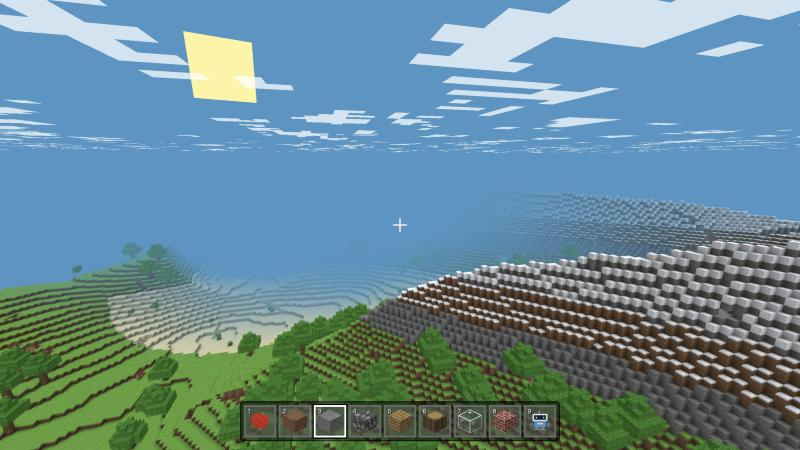
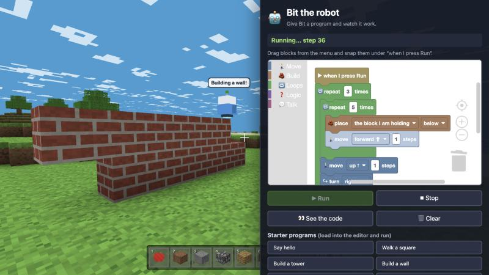
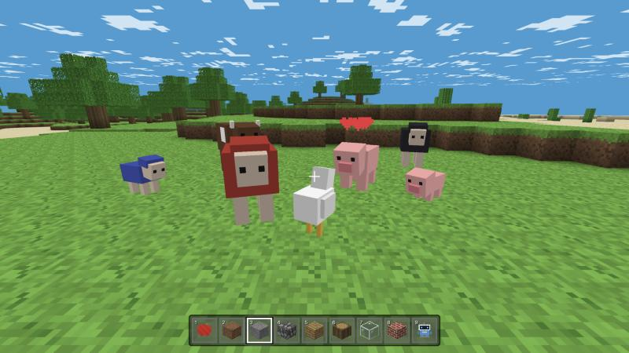
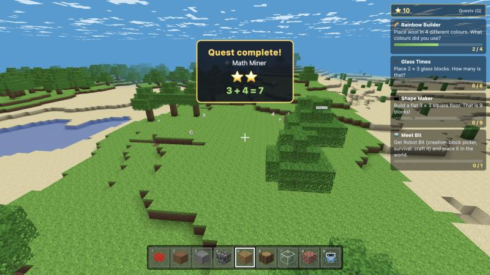
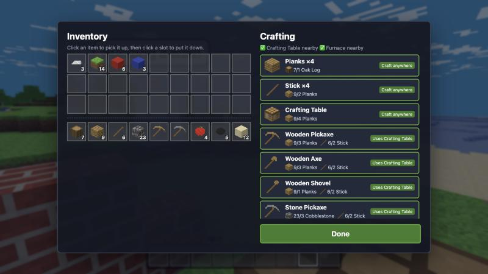
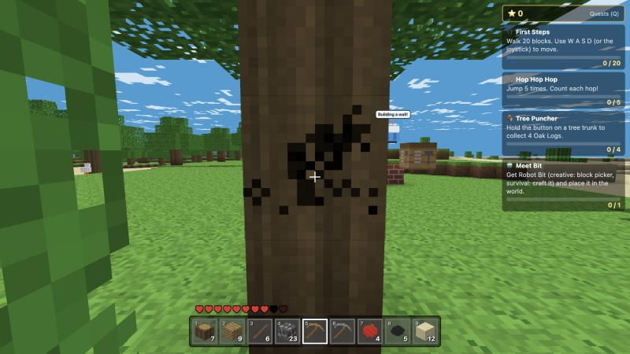
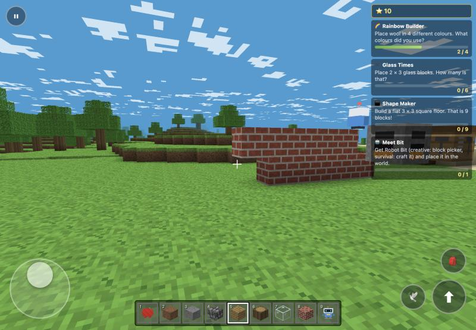
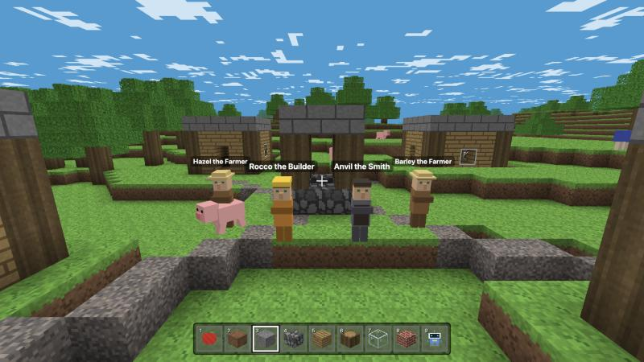
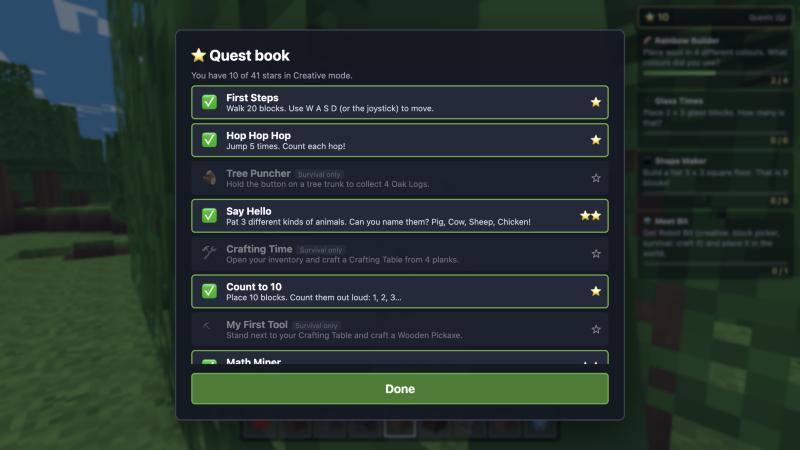

<p align="center">
  <a href="https://dynamic-web-lab.github.io/MiniCrafter/">
    
  </a>
</p>

<h1 align="center">MiniCrafter</h1>

<p align="center">
  <b>A free block-building adventure for kids that runs right in the browser.</b><br>
  Explore endless worlds, raise friendly animals, learn to code with a little robot and collect stars.
</p>

<p align="center">
  <a href="https://dynamic-web-lab.github.io/MiniCrafter/"></a>
</p>

<p align="center">
  
  
  
  
  
  
  <a href="https://github.com/Dynamic-Web-Lab/MiniCrafter/actions/workflows/ci.yml"></a>
  <a href="LICENSE"></a>
</p>

<p align="center">
  <a href="#-whats-inside">What's inside</a> ·
  <a href="#-made-for-kids">Made for kids</a> ·
  <a href="#-for-parents-and-teachers">Parents &amp; teachers</a> ·
  <a href="#-controls">Controls</a> ·
  <a href="#-run-it-yourself">Run it yourself</a> ·
  <a href="#-roadmap">Roadmap</a>
</p>

---

## ✨ What's inside

<table>
  <tr>
    <td width="50%" valign="top">
      
      <h3>🤖 Learn to code with Bit</h3>
      Snap together colourful code blocks and watch <b>Bit the robot</b> build towers, walls, stairs and tunnels one step at a time. The block it's running lights up, and <b>👀 See the code</b> shows the same program as real JavaScript-style text.
    </td>
    <td width="50%" valign="top">
      
      <h3>🐷 Friendly animals</h3>
      Pigs, cows, chickens and sheep in six wool colours. Pat them, feed them apples and they'll have <b>babies</b> that grow up. Shear sheep for coloured wool. Befriend a <b>dog or cat</b> as your named pet that follows you everywhere. Nothing can hurt you, and you can't hurt them.
    </td>
  </tr>
  <tr>
    <td width="50%" valign="top">
      
      <h3>⭐ Quests that teach</h3>
      36 quests cover counting, colours, shapes, simple maths (<i>"Break 3 + 4 dirt… 3 + 4 = 7!"</i>), animal names, a survival journey from first log to diamond, and a whole <b>coding track</b>. Every quest earns 1–3 stars.
    </td>
    <td width="50%" valign="top">
      
      <h3>🛠️ Click-to-craft recipe book</h3>
      No crafting patterns to memorise. Recipes you can make right now float to the top, and missing ingredients show in red. Make planks, a crafting table, a furnace, tools from wood to diamond, glass, bricks and lamps.
    </td>
  </tr>
  <tr>
    <td width="50%" valign="top">
      
      <h3>❤️ Gentle survival</h3>
      Mine with real tools, collect blocks and look after 10 hearts. There are <b>no monsters and no hunger</b>, only big falls and holding your breath too long hurt you, and if you faint you keep all your items. You can switch to <b>Creative</b> any time for unlimited blocks and flying.
    </td>
    <td width="50%" valign="top">
      
      <h3>📱 Plays great on tablets</h3>
      Use the joystick to walk and drag to look around. <b>Tap</b> to build and <b>press and hold</b> to dig. Big buttons and a tappable hotbar suit small hands, and it switches on automatically on iPad and Android tablets.
    </td>
  </tr>
</table>

<table>
  <tr>
    <td width="50%" valign="top">
      
      <h3>🏘️ Villages and trading</h3>
      Every world has a friendly village near the start: plank houses, a well, gravel paths and named villagers (farmers, builders, smiths). Swap your things for theirs, like <i>10 Cobblestone ➜ 1 Iron</i>. It's counting practice disguised as shopping.
    </td>
    <td width="50%" valign="top">
      
      <h3>📒 Quest book</h3>
      See every quest, the stars you've earned and what to try next. Press <code>Q</code>, or tap the ⭐ tracker on a tablet.
    </td>
  </tr>
</table>

### And there's more

- 🌍 **Endless procedural worlds:** plains, forests, deserts, snowy mountains, beaches, oceans, caves and ores. Share a world with friends by typing the same **seed**.
- 🌅 **Day and night:** sunsets, a sun and moon, stars and drifting clouds.
- 🔦 **Real light and dark caves:** sunlight spreads into caves and under roofs, and **torches** (stick + coal) and lamps light up warm, cozy circles. Caves get dark, but never pitch black.
- 🧱 **31 block types** drawn as pixel art, plus tools, apples and spawn eggs. Every texture and sound is generated in code, with **no image or audio files**.
- 🏊 **Swimming** with an underwater view, sprinting, jumping and flying (creative).
- 📶 **Works offline and installs like an app:** after the first visit the whole game, including Bit's code editor, is cached, so it keeps working without internet (great for car trips and school Chromebooks). Use **📲 Install MiniCrafter** in the menu, or *Add to Home Screen* on iPad.
- 🗂️ **Several worlds:** each child can have their own worlds (name, seed, creative or survival), with export and import as a file for backups or sharing with a friend.
- 💾 **Auto-save:** each world's buildings, inventory, animals, pets, robot program and stars are kept in the browser.

## 🧸 Made for kids

| | |
|---|---|
| 🚫 **No monsters, no fighting** | Animals are friends: you can pat, feed and shear them, but never hurt them. |
| 🔒 **No accounts, no chat, no ads** | Nothing to sign up for, no strangers to talk to, and nothing to buy. |
| 💾 **Private** | Saves stay in the browser on your device. There's no server and no tracking. |
| 🙂 **Forgiving** | Fainting keeps your items, hearts come back on their own, and tips guide new players. |
| 🤖 **Friendly errors** | If Bit's program hits a problem, Bit shakes its head, says why in plain words, and keeps going. |

## 🎓 For parents and teachers

MiniCrafter turns play into small, rewarding learning moments:

| Skill | How kids practise it |
|---|---|
| **Coding** | Sequencing, loops, nested loops, `if` / `repeat while` conditions and debugging, with Bit and 9 coding quests. "See the code" bridges block coding to typed JavaScript. |
| **Maths** | Counting to 10, addition (3 + 4), multiplication (2 × 3, 3 × 3), and measuring height and distance. |
| **Shapes and space** | Towers, square floors, walls and stairs; directions (forward, left, up, down). |
| **Colours** | Rainbow building with six wool colours. |
| **Nature** | Animal names and babies, day and night, wool growing back. |
| **Trading** | Swapping fixed amounts (10 dirt for 2 apples), checking "do I have enough?" and counting what you get back. |
| **Planning** | Gathering materials, crafting tools in the right order, and choosing the right tool for each block. |

## 🎮 Controls

| Action | Keyboard & mouse | Touch |
| :--- | :--- | :--- |
| Move | `W` `A` `S` `D` / arrow keys | Left joystick |
| Look around | Mouse | Drag on the right side |
| Jump / swim up / fly up | `Space` | ⬆ button |
| Sprint (fly down while flying) | `Shift` | ⬇ button (while flying) |
| Break block / pat an animal | Left click (hold) | Press and hold |
| Place block / use / feed / shear | Right click | Quick tap |
| Pick block | Middle click | — |
| Select hotbar slot | `1`–`9` / mouse wheel | Tap the slot |
| Inventory & crafting (creative: block picker) | `E` | 🎒 button |
| Quest book | `Q` | Tap the ⭐ tracker |
| Program Bit | Right click Bit | Tap Bit |
| Trade with a villager | Right click them | Tap them |
| Fly on/off (creative) | `F` | 🕊️ button |
| Pause / settings / game mode | `Esc` | ⏸ button |
| Debug info | `F3` | — |

Touch controls switch on automatically. You can force them with `?touch=1`, or turn them off with `?touch=0`.

<details>
<summary><b>📖 Full feature guide</b> (game modes, Bit, animals, quests)</summary>

### Game modes

Switch at any time from the pause menu (`Esc`).

- **Creative:** unlimited blocks, instant breaking, flying, spawn eggs and Robot Bit in the block picker.
- **Survival (gentle):**
  - **Mining:** mining takes time, and better tools are faster. Ores need the right pickaxe: iron needs Stone, gold and diamond need Iron.
  - **Crafting:** blocks drop items into a 36-slot inventory. Some recipes need a Crafting Table or Furnace within 4 blocks.
  - **Hearts:** 10 hearts. Only falls of more than 4 blocks and running out of air hurt you. Hearts regenerate, and apples (sometimes dropped by leaves) heal.

### Bit the code robot

- **Getting Bit:** in creative, pick **Robot Bit**. In survival, craft it at a Crafting Table from 3 Iron Ingots + 1 Glass + 1 Coal.
- **Placing and programming:** right-click a block to place Bit; it faces the way you look. Right-click Bit to open the code editor (powered by [Blockly](https://developers.google.com/blockly)).
- **Blocks:** move, turn, dig, place (any block or the one you hold), say, repeat, repeat while, if/else, and the checks *there is a block*, *the block is…* and *not*.
- **Running:** ▶ Run at 1×/2×/4× speed, ⏹ Stop any time.
- **Starter programs** (tower, wall, stairs, tunnel, square, explore) load into the editor so kids can remix them.
- **Survival:** Bit uses your blocks and hands you what it digs.
- **Safety:** Bit can't break bedrock, stays within 64 blocks of you, and runaway loops stop with a friendly message.

### Friendly animals

- **Pat** (left click): the animal hops happily.
- **Feed an apple** (right click): hearts appear, and two animals in love make a baby. Feeding babies helps them grow.
- **Shear sheep** (right click without an apple): 1–3 wool in the sheep's colour, which regrows after a minute.
- **Pets:** now and then a lone dog or cat appears. Feed it an apple and it becomes your pet with its own name tag and a red collar. It follows you and catches up if you go far. Right-click it to make it sit and stay, or follow again. Feed two pets for a puppy or kitten. Creative has dog and cat eggs.
- Animals you've fed, bred or spawned are saved with your world.

### Quests and stars

- **Quest tracker** (top right): shows the next 3 quests plus the next 🤖 coding quest. Press `Q` for the quest book.
- **Quest list:**
  - **Explorer:** First Steps, Hop Hop Hop, Say Hello, Count to 10, Math Miner, Woolly Jumper, Tower Power, Rainbow Builder, Glass Times, Shape Maker, Best Friend, Animal Family, Light the Way, Village Visit, Splash!, Mountain Top, Star Gazer.
  - **Survival:** Tree Puncher → Crafting Time → My First Tool → Stone Age → Snack Time → Hot Stuff → Window Maker → Fair Trader → Iron Hunter → Diamond Dreams.
  - **Coding:** Meet Bit → First Program → Loop the Loop → Bit the Builder → Up, Up, Up → Tunnel Digger → My Own Program → Loop Inside a Loop → Smart Robot.

</details>

## 🚀 Run it yourself

The game is just static files: no build step and no `npm install`.

```bash
git clone https://github.com/Dynamic-Web-Lab/MiniCrafter.git
cd MiniCrafter
python3 -m http.server 8765
```

Open http://localhost:8765. To play on a tablet on the same Wi-Fi, open `http://<your-computer-ip>:8765`.

It needs a modern browser with WebGL. Everything, including three.js and Blockly, is bundled in `vendor/`, so there are no external requests.

**Deploy:** push to GitHub and enable **GitHub Pages** on the `main` branch root (that's how the [live version](https://dynamic-web-lab.github.io/MiniCrafter/) is hosted), or drop the folder on any static host.

<details>
<summary><b>🧩 How it's built</b> (for developers)</summary>

- **Offline:** `sw.js` precaches every file (stale-while-revalidate) and `manifest.webmanifest` makes it installable. Bump `VERSION` in `sw.js` when files change. The service worker is skipped on localhost so development always sees fresh files (add `?sw=1` to test it).
- **Rendering:** [three.js](https://threejs.org/) 0.160 (vendored) loaded through an import map. Chunks are 16×16×96 with hidden-face culling and per-vertex ambient occlusion, so each chunk layer is a single draw call.
- **Lighting:** sky light and block light (0–15) are flood-filled while meshing, over the chunk plus a 15-block margin, and smoothed per vertex. A small shader hook mixes them with the time of day, so torchlight stays warm at night.
- **Everything procedural:** a seeded Perlin-noise world, a pixel-art texture atlas painted in code, and Web Audio sound effects synthesized on the fly.
- **Bit's programs** are a small JSON tree run by a generator-based interpreter that the game loop advances one animated step at a time: no `eval`, it can stop instantly, and loops are guarded.

```
index.html          Page shell, menus, HUD, import map
sw.js               Service worker for offline play
manifest.webmanifest, icons/  Installable app metadata and icons
vendor/             three.js and Blockly (see vendor/README.md for licenses)
style.css           UI styles
src/main.js         Boot, game loop, input, pointer lock, UI, saving
src/world.js        Chunks, terrain generation, meshing + AO, raycast, streaming
src/player.js       Player physics and collision
src/blocks.js       Block registry (IDs are saved, never renumber them)
src/items.js        Items, tools, mining rules, drops, recipes, item icons
src/inventory.js    36-slot survival inventory
src/survival.js     Hearts, breath, fall damage, regen, timed mining + cracks
src/craftui.js      Inventory + recipe-book crafting screen
src/mobs.js         Friendly animals: models, wandering AI, breeding, shearing
src/touch.js        On-screen joystick, look-drag, tap/hold and buttons
src/quests.js       Quests, stars and progress tracking
src/robot.js        Bit: model, program interpreter, animated actions
src/robotui.js      Bit's panel: code editor, run/stop, speed, starters
src/robotblocks.js  Blockly blocks, workspace <-> program conversion, code view
src/worlds.js       Saved worlds list, export / import
src/villages.js     Village placement, layout, villager trades
src/textures.js     Procedural texture atlas + icons
src/sky.js          Day/night, sun, moon, stars, clouds
src/particles.js    Block-break particles
src/audio.js        Synthesized sounds
src/noise.js        Seeded Perlin noise and hashes
```

- **Tests:** `tests/smoke.mjs` boots the real game in headless Chromium and checks world generation, lighting, Bit, animals, Blockly, worlds, touch mode, offline caching and console errors. It runs on every PR (GitHub Actions). Locally: `npm i --no-save playwright@1.47.2 && SMOKE_CHANNEL=chrome node tests/smoke.mjs`.
- **Adding a block:** add a tile painter in `textures.js` and a `def(...)` line in `blocks.js`.
- **Debugging:** `window.minicrafter` in the browser console exposes `world`, `player`, `inv`, `robot`, `quests`, `save()`, `setMode()` and `step(n)`. `step(n)` advances frames by hand, which is handy in a background tab.

</details>

## 🧭 Roadmap

Next up are bouncy trampoline and speed blocks, musical step-stones, magic building tools with undo, a cozy garden with frogs and butterflies, one-click share links and more. See the phased plan in **[ROADMAP.md](ROADMAP.md)**.

Have an idea? [Open an issue](https://github.com/Dynamic-Web-Lab/MiniCrafter/issues).

## 🙏 Credits

Built by [Dynamic Web Lab](https://dynamicweblab.com) and released under the [MIT License](LICENSE). Made with [three.js](https://threejs.org/) and [Blockly](https://developers.google.com/blockly). MiniCrafter is an original game inspired by block-building sandboxes, with its own code, art and sounds.
